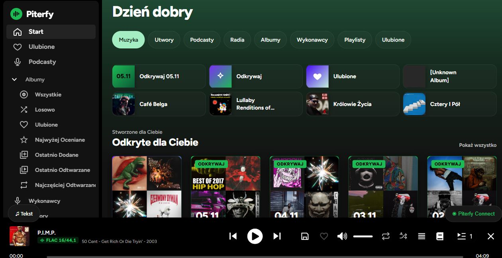
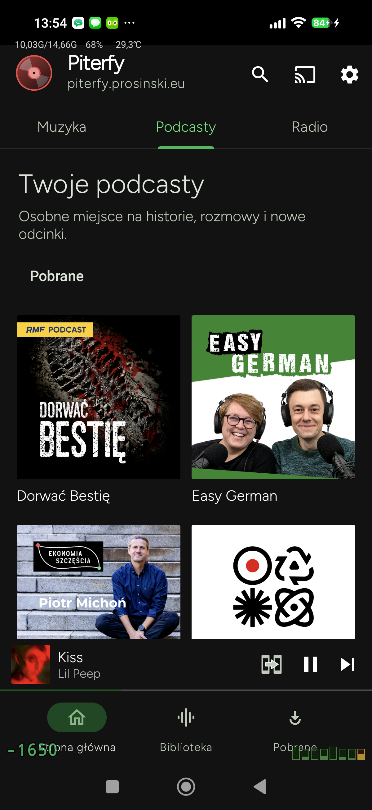
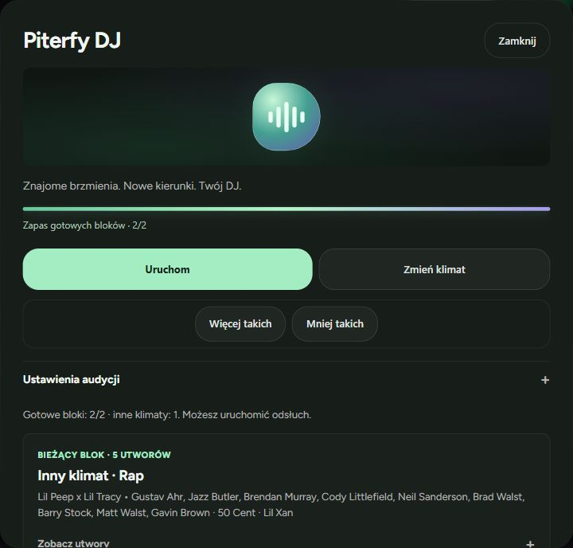
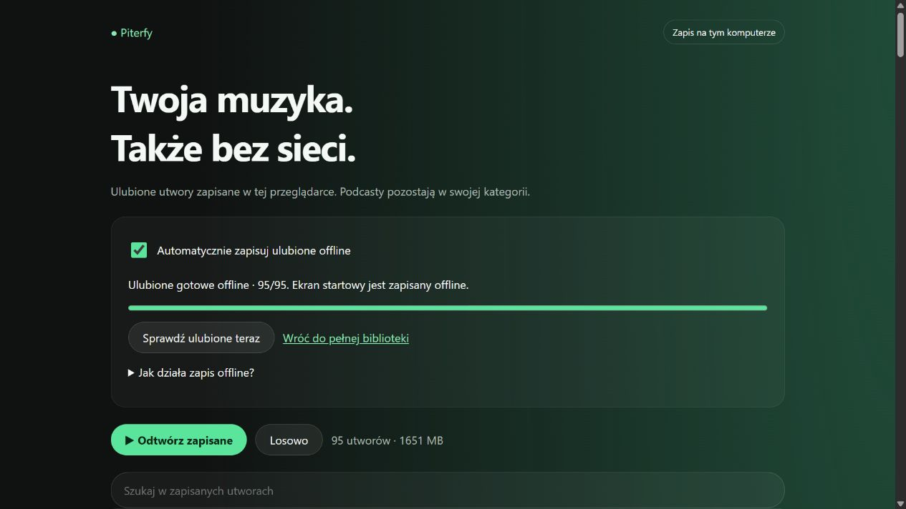
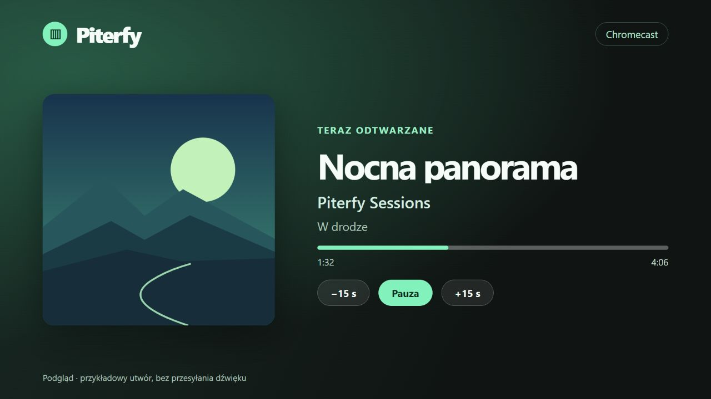

  

<h1 align="center">Piterfy</h1>

<strong>Własna biblioteka muzyki, podcastów i radia — na Androidzie i w przeglądarce.</strong>

  <a href="https://github.com/pi0trdotsys/piterfy-android/releases/latest">Pobierz APK</a> ·
  <a href="https://piterfy.prosinski.eu/app/">Otwórz Piterfy Web</a> ·
  <a href="USAGE.md">Instrukcja obsługi</a>

Piterfy łączy natywną aplikację Android z odtwarzaczem webowym opartym na Navidrome. Słuchaj swojej biblioteki, odkrywaj nowe utwory z DJ-em i wracaj do polubionej muzyki bez internetu.

## Zobacz Piterfy

| Android · osobny katalog podcastów | Web · Piterfy DJ |
| :---: | :---: |
|  |  |

**Piterfy TV · podgląd własnego odbiornika Chromecast**

[Otwórz interaktywny podgląd TV](https://piterfy.prosinski.eu/piterfy-ui/cast-receiver.html?preview=1) · [Konfiguracja odbiornika](connect/README.md#piterfy-tv-chromecast)

## Co oferuje Piterfy

| Funkcja | Jak działa |
| --- | --- |
| **DJ i Odkrywaj** | DJ zapowiada muzykę przed odtworzeniem. Gotowe bloki skracają oczekiwanie, a „Więcej takich” i „Mniej takich” wpływają na kolejne rekomendacje. |
| **Piterfy Connect** | Przekazuj kolejkę i bieżącą pozycję między Androidem a przeglądarką na tym samym koncie. |
| **Ulubione offline** | Android automatycznie zleca pobieranie polubionych utworów przez Wi-Fi. W webie otwarta karta zapisuje muzykę w pamięci bieżącego profilu przeglądarki. |
| **Podcasty i radio** | Podcasty mają osobną kategorię i kolejkę, z zapisem miejsca odsłuchu. Android może automatycznie pobierać nowe odcinki subskrybowanych audycji. |
| **Odtwarzacz** | Zsynchronizowane teksty, konfigurowalne płynne przejścia i edycja kolejki. Android pokazuje bieżące wyjście dźwięku, a web oferuje pływający mini-odtwarzacz w obsługiwanych przeglądarkach. |

## Zacznij słuchać

1. Pobierz APK z [najnowszego wydania](https://github.com/pi0trdotsys/piterfy-android/releases/latest). Aplikacja wymaga Androida 7.0 lub nowszego.
2. Wybierz `app-tempus-release.apk` z Android Auto i Chromecastem albo `app-degoogled-release.apk` bez usług Google. Nazwy plików odpowiadają wariantom kompilacji; oba instalują **Piterfy**.
3. Dodaj adres swojego serwera Navidrome lub serwera zgodnego z Subsonic i zaloguj się. Funkcje takie jak DJ i Connect wymagają dodatkowych usług Piterfy na serwerze. [Wersja webowa Piterfy](https://piterfy.prosinski.eu/app/) również wymaga konta na tym serwerze.

Aby przygotować web do słuchania bez internetu, otwórz **Offline**, będąc online, i poczekaj na zakończenie zapisu. Potem otwórz ten sam adres w tym samym profilu przeglądarki. Na Androidzie ustawienia automatycznego pobierania są w **Pobrane → Centrum pobierania**.

## Kod i dokumentacja

[Wydania](https://github.com/pi0trdotsys/piterfy-android/releases) · [Zmiany i budowanie Androida](PITERFY.md) · [Wdrożenie Connect](connect/README.md) · [Zgłoś problem](https://github.com/pi0trdotsys/piterfy-android/issues)

Piterfy rozwija kod [Tempus](https://github.com/eddyizm/tempus), który wywodzi się z [Tempo](https://github.com/CappielloAntonio/tempo) autorstwa CappielloAntonio. Dziękujemy także [SeattleGuy](https://github.com/SeattleGuy) za projekt logo Tempus oraz [współtwórcom Tempus](https://github.com/eddyizm/tempus/graphs/contributors). Kod jest dostępny na licencji [GPL-3.0](LICENSE), a używany krój Figtree na [SIL Open Font License](third-party/Figtree-OFL.txt).
